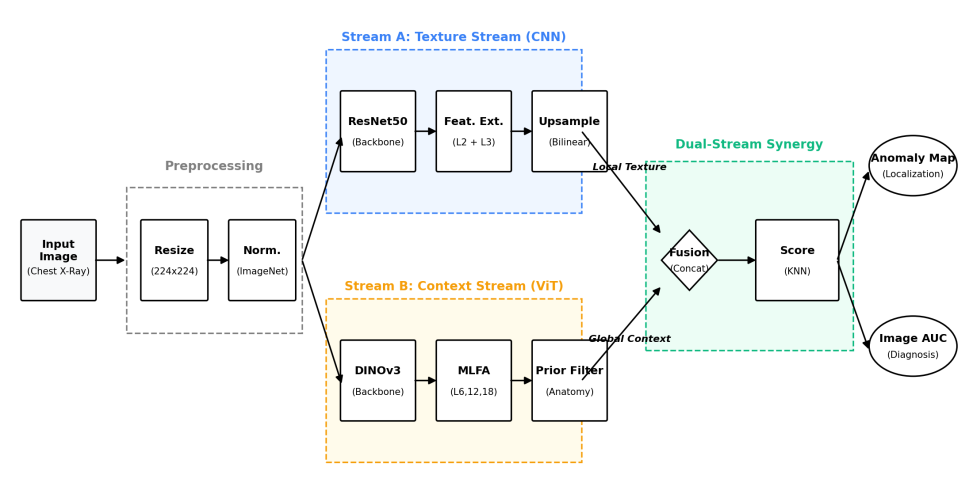
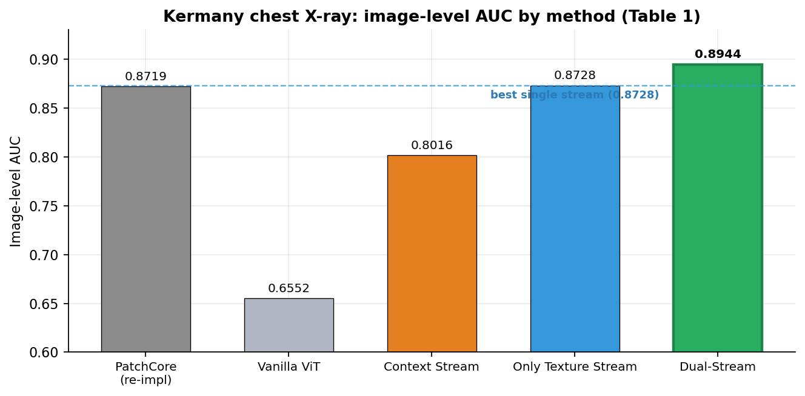
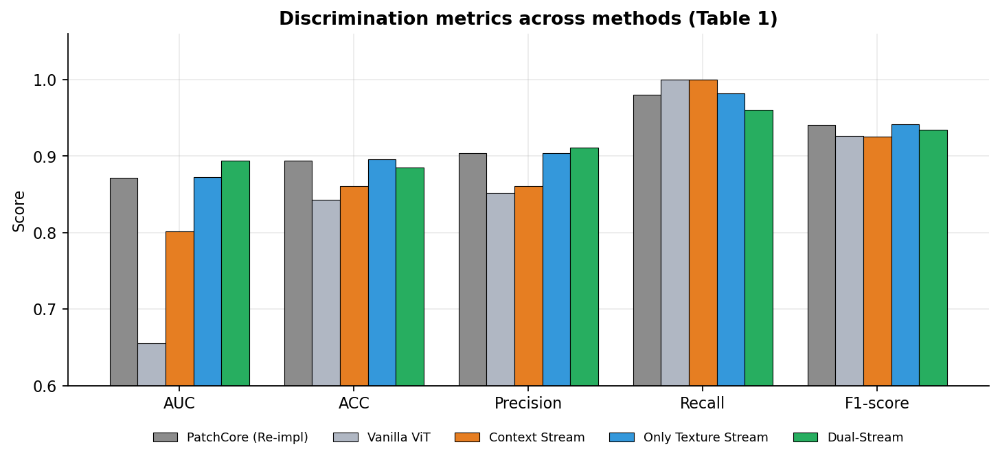
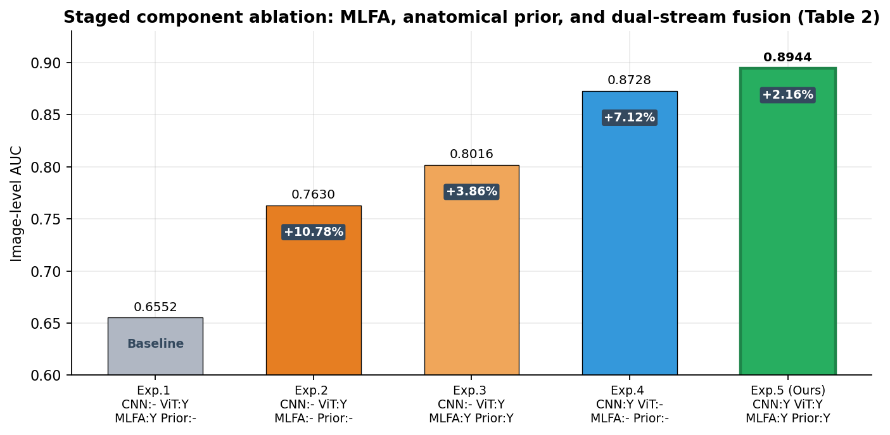
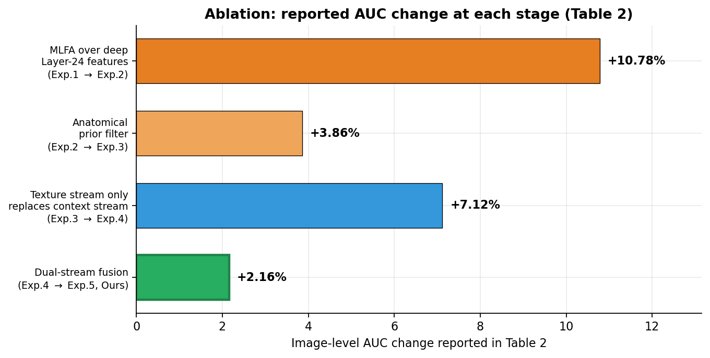
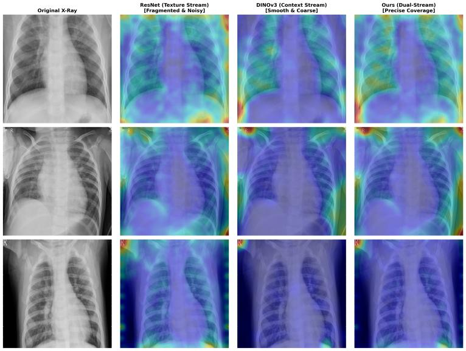

# Dual-Stream Feature Synergy for Chest X-ray Anomaly Detection

Reference implementation of the paper:

> **Dual-Stream Feature Synergy and Prior Fusion Method for Chest X-ray Anomaly Detection**
> Chenxi Gao — School of Artificial Intelligence, Xidian University, Xi'an, Shaanxi, China
> ICIAAI 2026, May 22–24, Singapore · DOI: [10.4108/eai.22-5-2026.2365105](https://doi.org/10.4108/eai.22-5-2026.2365105)

[](https://doi.org/10.4108/eai.22-5-2026.2365105)
[](#-task-definition)
[](#-results)

---

## ⚠️ Important: the results in this repository are reported, not reproduced

The published numbers are **transcribed from the paper** and frozen in
[`results/reported_metrics.json`](results/reported_metrics.json). They were **not** regenerated by running this
code, because the Kermany chest X-ray dataset and the DINOv3 ViT-L/16 weights are deliberately **not downloaded**
and **not redistributed** here.

What this repository therefore contains:

| Component | Status |
| --- | --- |
| Method implementation (`src/`) | ✅ Complete and runnable |
| Implementation sanity check (`scripts/validate_pipeline.py`) | ✅ Runs offline on synthetic tensors, 71/71 checks pass |
| Reported metrics (Tables 1 & 2) | ✅ Transcribed verbatim from the paper |
| Figures rendered from reported metrics | ✅ Generated by `scripts/make_reported_figures.py` |
| Paper architecture & heatmap figures | ✅ Extracted from the published PDF |
| Dataset / pretrained weights | ❌ Not included — see [Dataset](#-dataset) and [Model weights](#-model-weights) |
| End-to-end accuracy reproduction | ❌ Not performed here — follow [Reproducing the paper](#-reproducing-the-paper) |

---

## 📄 Abstract

Single-stream unsupervised anomaly detection for chest radiographs suffers from two opposing weaknesses: CNNs
ignore global context, while pre-trained ViTs ignore layered deep features and lose fine-grained pathological
texture. This work proposes a **dual-stream synergy architecture** that integrates a *texture* stream and a
*context* stream. The texture branch uses ResNet50 local features at high frequencies; the context branch
combines anatomy prior filters, background noise suppression, and multi-level aggregation from DINOv3 to recover
texture at shallow and middle levels. On the Kermany chest X-ray database the dual-stream model reaches an
image-level **AUC of 0.8944**, outperforming DINOv3 alone (AUC 0.6552) and ResNet50 alone (AUC 0.8728), showing
that the CNN inductive bias and the Transformer's global semantics are complementary for zero-shot diagnosis.

---

## 🏗️ Architecture



*Figure 1 of the paper. **Texture stream** (top, blue) uses ResNet50 to capture local high-frequency texture.
**Context stream** (bottom, orange) uses DINOv3 with MLFA and the Anatomical Prior Filter to capture global
context and suppress background noise. The **Dual-Stream Synergy** module (green) fuses both streams into
localization anomaly maps and an image-level diagnostic score.*

### Texture stream — Eq. 1

The feature map `φ₃(x)` from Layer 3 is bilinearly upsampled to the spatial size of Layer 2's `φ₂(x)` and the two
are concatenated along the channel dimension:

```
F_tex(x) = Concat( φ₂(x), Upsample(φ₃(x)) )                              (Eq. 1)
```

Only the **middle** stages (Layer 2 and Layer 3) are used. Layer 1 carries only edges and colour; Layer 4 has lost
too much resolution. This balances *semantic depth* against *spatial resolution*, yielding features at 1/8 and
1/16 of the input resolution — `F_tex ∈ ℝ^(1536×28×28)` for a 224×224 input.

### Context stream — Eq. 2 (MLFA)

Multi-Level Feature Aggregation concatenates the selected layer set `S = {6, 12, 18}`:

```
F_ctx(x) = Concat_{l ∈ S} ψ_l(x) = [ ψ₆(x), ψ₁₂(x), ψ₁₈(x) ]             (Eq. 2)
```

where each `ψ_l(x) ∈ ℝ^(N×D)` with `N = 196` patch tokens and `D = 1024`, giving
`F_ctx ∈ ℝ^(196×3072)`. **Layer 24 is deliberately excluded** — it is the over-smoothed, "macroscopic" semantic
level responsible for the semantic gap quantified in Section 2.2 of the paper.

### Anatomy-guided background suppression — Eq. 3

Air outside the body attenuates little radiation and is therefore dark. Patches `P_i` whose mean optical density
`μ(P_i)` does not exceed `τ` are masked out:

```
M_i = 1  if μ(P_i) > τ,   else 0            with τ = 30                 (Eq. 3)
```

Features below the threshold are eliminated, so anomaly scores depend only on lung-tissue pathology.

### Adaptive fusion — Eqs. 4–5

The two streams produce scores on different numerical scales, so naive overlaying is biased toward the
higher-magnitude stream. Min-Max normalization aligns them to `[0, 1]`:

```
Ŝ_k = (S_k − min S_k) / (max S_k − min S_k),   k ∈ {tex, ctx}            (Eq. 4)
```

then a weighted linear combination yields the final image-level score:

```
S_final = λ · Ŝ_tex + (1 − λ) · Ŝ_ctx            with λ = 0.5             (Eq. 5)
```

With `λ = 0.5`, local texture evidence and global structural evidence contribute equally. The paper describes the
result as a *"dual validation"*: agreement between the streams raises confidence, while regions flagged as
pathological by ResNet but normal by DINO — including background — are damped, alleviating false positives.

---

## 🎯 Task definition

**One-Class Classification (OCC) / zero-shot unsupervised anomaly detection.**

- **Training set:** 1,341 radiologist-validated **normal** chest X-rays only. The model learns the manifold of
  healthy anatomy.
- **Test set:** a mix of normal radiographs and abnormal radiographs.
- **Anomaly class:** `pneumonia`, which is the pathology the model must flag.
- **No leakage:** no training image appears in the test set.
- **No supervision:** both backbones are **frozen**; only forward inference is performed. There is no fine-tuning,
  no gradient computation, and no gradient update.
- **Preprocessing:** all images forced to RGB, resized to 224×224 with bilinear interpolation, normalized with
  ImageNet statistics.

---

## 📊 Results

All values are transcribed from the paper. **Reported, not reproduced** — see the warning at the top.

### Table 1 — Main results comparison

| Method | Backbone | Pre-training | AUC | ACC | Precision | Recall | F1-score |
| --- | --- | --- | ---: | ---: | ---: | ---: | ---: |
| **Baselines** | | | | | | | |
| PatchCore (re-impl) [4] | ResNet50 | ImageNet | 0.8719 | 0.8937 | 0.9041 | 0.9800 | 0.9405 |
| Vanilla ViT [8] | DINOv3-L | LVD-142M | 0.6552 | 0.8428 | 0.8521 | 1.0000 | 0.9259 |
| **Ablations (Ours)** | | | | | | | |
| Context Stream | DINOv3-L (with MLFA) | LVD-142M | 0.8016 | 0.8611 | 0.8606 | 1.0000 | 0.9251 |
| Only Texture Stream | ResNet50 (Layers 2+3) | ImageNet | 0.8728 | 0.8954 | 0.9042 | 0.9820 | 0.9415 |
| **Dual-Stream (Ours)** | ResNet50 + DINOv3 | Hybrid | **0.8944** | 0.8851 | **0.9108** | 0.9600 | 0.9348 |



*Image-level AUC for every method of Table 1. The dashed line marks the strongest single stream. The dual-stream
model reaches the highest AUC (0.8944).*



*All Table 1 metrics side by side. Note that the dual-stream model does not win every column: the texture-only
stream edges it out on Accuracy and F1, while the dual stream leads on AUC and Precision.*

### Table 2 — Ablation study

| Exp. ID | Stream A (CNN) | Stream B (ViT) | MLFA (Layers 6, 12, 18) | Anatomy Filter | AUC | Improvement |
| ---: | :---: | :---: | :---: | :---: | ---: | ---: |
| 1 | × | √ | × (Layer 24 only) | × | 0.6552 | Baseline |
| 2 | × | √ | × | × | 0.7630 | +10.78% |
| 3 | × | √ | √ | √ | 0.8016 | +3.86% |
| 4 | √ | – | – | – | 0.8728 | +7.12% |
| **5 (Ours)** | √ | √ | √ | √ | **0.8944** | **+2.16%** |



*Staged ablation of Table 2.*



*The `Improvement` column of Table 2, exactly as printed. Note that not every stage is an additive component
insertion: Exp. 3 → Exp. 4 replaces the context stream with the texture stream, so its +7.12% is a cross-stream
comparison rather than a marginal gain on top of Exp. 3.*

### Key findings

- **MLFA contributes ≈ +10% AUC** over deep Layer-24-only features, confirming the semantic-gap hypothesis:
  deep ViT layers summarise organ-level semantics and weakly map high-frequency pathology such as ground-glass
  opacities.
- **The anatomical prior filter adds ≈ +4% AUC** by purging non-anatomical background noise from the feature space.
- **The texture stream alone is a very strong baseline** (0.8728), demonstrating the robustness of the CNN
  inductive bias for this task.
- **Dual-stream fusion adds a further +2.16% AUC** over the strongest single stream, evidencing
  texture–context complementarity.

### Qualitative localization



*Figure 2 of the paper, columns left to right: **(a)** original chest X-ray; **(b)** texture stream (ResNet) maps
with fragmented high-frequency noise; **(c)** context stream (DINOv3) maps with over-smooth and coarse
localization; **(d)** dual-stream maps with better background suppression and accurate lesion mapping.*

The model cannot emit bounding boxes — no box supervision is available — but the anomaly heatmaps do localize the
centres of pulmonary consolidation and ground-glass opacities. The paper calls this **"soft localization"**: it
costs no annotation and supports clinician review, screening efficiency, and interpretation. `scripts/render_heatmaps.py`
reproduces this four-column layout from your own inference outputs.

---

## 📦 Dataset

**Not included in this repository.** The Kermany Chest X-ray dataset (Cell 2018) is publicly available; download it
yourself from one of:

- **Kaggle — Chest X-Ray Images (Pneumonia):** <https://www.kaggle.com/datasets/paultimothymooney/chest-xray-pneumonia>
- **Mendeley Data (original release):** <https://data.mendeley.com/datasets/rscbjbr9sj/2>
- **Original paper:** Kermany, D. S., et al. *Identifying medical diagnoses and treatable diseases by image-based
  deep learning.* Cell, pp. 1122–1131 (2018)

The standard release is organised as `train/{NORMAL,PNEUMONIA}` and `test/{NORMAL,PNEUMONIA}`. Existing X-ray
copies you may already have may instead be named `train/`, `test_A/`, and `test_B/` — this repository's loader
accepts several common layouts case-insensitively.

Expected layout:

```
<dataset-root>/
├── train/
│   ├── NORMAL/          # 1,341 normal radiographs — the only training data used
│   └── PNEUMONIA/
├── test/
│   ├── NORMAL/
│   └── PNEUMONIA/
```

> ⚠️ **Split caveat.** The paper's OCC protocol keeps **only the normal images** for training and builds the test
> set by mixing normal and abnormal samples, with no overlap. The stock Kaggle `test/` split contains very few
> images, so for a faithful reproduction you should re-derive the split as described in the paper rather than
> using the Kaggle test folder as-is. `src/dataset.py` provides `discover_manifest`, `split_normal_train`, and CSV
> manifest helpers to make the split explicit and reproducible.

Point the code at your local copy:

```bash
export CXR_DATASET_ROOT=/path/to/chest_xray
```

## 🧠 Model weights

**Not included in this repository.** Two frozen backbones are needed:

| Stream | Backbone | Weights | Notes |
| --- | --- | --- | --- |
| Texture | ResNet50 | ImageNet | Fetched automatically by `torchvision` on first use |
| Context | DINOv3 ViT-L/16 | LVD-142M | Download separately, or let `transformers` fetch it |

DINOv3 ViT-L/16:

- **Hugging Face hub id:** `facebook/dinov3-vitl16-pretrain-lvd1689m`
- **Repository:** <https://github.com/facebookresearch/dinov3>
- Requires `transformers >= 4.56`

Download the weights into a local directory and set `weights_dir` in `ContextStreamConfig` — the code defaults to
`local_files_only=True` and will **not** silently reach out to the network:

```python
from src import ContextStreamConfig

cfg = ContextStreamConfig(weights_dir="/path/to/dinov3-vitl16-pretrain-lvd1689m")
```

The ViT-L/16 patch grid for a 224×224 input is 14×14 = **196 patch tokens** with embedding dimension **1024**,
exactly as the paper's `N = 196`, `D = 1024`. The `assert_patch_grid` helper enforces this, and DINOv3's four
register tokens plus the CLS token are stripped before aggregation.

---

## 📁 Repository structure

```
.
├── src/
│   ├── config.py             # every hyper-parameter, as reported in the paper
│   ├── streams/
│   │   ├── texture_stream.py # ResNet50 Layer 2 + Layer 3        (Eq. 1)
│   │   └── context_stream.py # DINOv3 ViT-L, MLFA {6, 12, 18}    (Eq. 2)
│   ├── anatomical_prior.py   # optical-density ROI masking       (Eq. 3)
│   ├── knn.py                # K = 50, Euclidean memory-bank k-NN
│   ├── fusion.py             # Min-Max normalization + fusion    (Eq. 4, Eq. 5)
│   ├── pipeline.py           # end-to-end detector + ablation modes
│   ├── metrics.py            # AUC, ACC, Precision, Recall, F1, NPV, heatmaps
│   └── dataset.py            # OCC protocol, manifests, normal-only validation split
├── scripts/
│   ├── validate_pipeline.py     # offline sanity check (synthetic tensors, no downloads)
│   ├── make_reported_figures.py # renders the figures from reported_metrics.json
│   └── render_heatmaps.py       # four-column Figure 2 layout from your own maps
├── configs/config.json       # paper settings in JSON form
├── results/
│   ├── reported_metrics.json # Tables 1 & 2, verbatim
│   └── figures/              # figures 3-6, generated from reported_metrics.json
├── docs/figures/             # paper Figures 1 & 2, extracted from the PDF
└── paper/                    # the published paper PDF
```

### Mapping from paper equations to code

| Paper | Code |
| --- | --- |
| Eq. 1 — `F_tex = Concat(φ₂, Upsample(φ₃))` | [`src/streams/texture_stream.py`](src/streams/texture_stream.py) → `TextureStream.forward` |
| Eq. 2 — `F_ctx = [ψ₆, ψ₁₂, ψ₁₈]` | [`src/streams/context_stream.py`](src/streams/context_stream.py) → `ContextStream.forward` |
| Eq. 3 — ROI mask `M_i = μ(P_i) > τ` | [`src/anatomical_prior.py`](src/anatomical_prior.py) → `AnatomicalPriorFilter.mask` |
| Eq. 4 — Min-Max `Ŝ_k` | [`src/fusion.py`](src/fusion.py) → `min_max_normalize` |
| Eq. 5 — `S_final = λŜ_tex + (1−λ)Ŝ_ctx` | [`src/fusion.py`](src/fusion.py) → `DualStreamSynergy.forward` |
| k-NN scoring, K = 50 | [`src/knn.py`](src/knn.py) → `KNNAnomalyDetector` |
| Table 2 ablation settings | [`src/pipeline.py`](src/pipeline.py) → `score_single_stream`, `score_vanilla_vit` |

---

## 🚀 Usage

### Verify the implementation offline (no dataset, no weights, no GPU)

```bash
pip install -r requirements.txt
python scripts/validate_pipeline.py
```

This exercises preprocessing, Eqs. 1–5, k-NN scoring, all metrics, and heatmap generation on **synthetic tensors
with stub backbones**. It validates the *implementation*, not the paper's accuracy, and it downloads nothing.

### Inspect the paper's configuration

```python
from src import DualStreamConfig

cfg = DualStreamConfig().validate()
print(cfg.fusion.lam, cfg.prior.tau, cfg.knn.n_neighbors, cfg.context.feature_layers)
# 0.5 30.0 50 (6, 12, 18)
```

### Run the detector (once you have the dataset and the weights)

```python
import torch
from src import DualStreamAnomalyDetector, DualStreamConfig
from src.streams import normalize_batch

cfg = DualStreamConfig(device="cuda")
cfg.context.weights_dir = "/path/to/dinov3-vitl16-pretrain-lvd1689m"

detector = DualStreamAnomalyDetector(cfg)
# raw tensors on the [0, 255] scale: the anatomical prior needs the physical scale
detector.fit_raw(normal_train_raw, batch_size=8, verbose=True)

out = detector.score(test_raw, raw_images=test_raw, batch_size=8)
# out["fused"]           -> (T,) image-level scores    (Eq. 5)
# out["heatmaps"]        -> (T, 1, 224, 224) localization maps
# out["roi_mask"]        -> (T, 196) anatomical ROI mask (Eq. 3)

from src import binary_classification_metrics
print(binary_classification_metrics(out["fused"], labels))
```

### Regenerate the reported-result figures

```bash
python scripts/make_reported_figures.py
```

Plots `results/reported_metrics.json` into `results/figures/`. It runs no model and downloads nothing.

### Render the Figure 2 heatmap layout from your own run

```bash
python scripts/render_heatmaps.py --npz run.npz --out results/figures/fig7_localization.png
```

`run.npz` must contain `images` `(T, H, W)`, and `texture`, `context`, `fused` maps of shape `(T, h, w)`.

---

## 🔬 Reproducing the paper

The published protocol, for anyone who wants to regenerate the numbers:

1. **Hardware / framework** — PyTorch 2.0 on an NVIDIA RTX 4090 (24 GB).
2. **Preprocess** — resize to 224×224 bilinear, force RGB, normalize with ImageNet statistics.
3. **Build the memory bank** — run frozen ResNet50 and frozen DINOv3 in forward-only mode over the 1,341 normal
   training radiographs. No gradients, no fine-tuning.
4. **Score the test set twice** — once per stream, with k-NN (`K = 50`, Euclidean) against the corresponding
   memory bank.
5. **Normalize and fuse** — apply Eq. 4 per stream, then Eq. 5 with `λ = 0.5`.
6. **Select the threshold on a held-out normal validation split**, then apply it unchanged to the test set to
   obtain Accuracy, Precision, Recall, F1, and NPV.
7. **Localization** — upsample the fused patch scores to a heatmap and compare against lesion regions.

`src/dataset.py` exposes `split_normal_train` for step 6 and `src/fusion.py` exposes `sweep_lambda` to redo the
`λ` search of step 5.

---

## ⚠️ Limitations

As acknowledged in the paper's conclusion:

- **No bounding-box supervision**, so localization accuracy is modestly lower than fully supervised detectors such
  as the YOLO family [11]; outputs are *soft* localization hints, not boxes.
- **Dual-stream computation exceeds single-stream baselines** in inference cost, since two frozen backbones run
  per image.
- The intended use is **screening assistance in low-resource settings**, complementing rather than replacing a
  radiologist's review.

Future work proposed by the paper: lightweight structures (e.g. MobileViT) combined with knowledge distillation,
optimizing latency to meet real-time thresholds on mobile medical devices.

---

## 📖 Citation

```bibtex
@inproceedings{gao2026dualstream,
  title     = {Dual-Stream Feature Synergy and Prior Fusion Method for Chest X-ray Anomaly Detection},
  author    = {Gao, Chenxi},
  booktitle = {ICIAAI 2026, May 22-24, Singapore, Singapore},
  year      = {2026},
  doi       = {10.4108/eai.22-5-2026.2365105}
}
```

## 📚 References

1. Kelly, C. J., Karthikesalingam, A., Suleyman, M., Corrado, G., King, D. *Key challenges for delivering clinical impact with artificial intelligence.* BMC Medicine, pp. 195 (2019)
2. Litjens, G., et al. *A survey on deep learning in medical image analysis.* Medical Image Analysis, pp. 60–88 (2017)
3. Ruff, L., et al. *A unifying review of deep and shallow anomaly detection.* Proceedings of the IEEE, pp. 756–795 (2021)
4. Roth, K., Pemula, L., Zepeda, J., Schölkopf, B., Brox, T., Gehler, P. *Towards total recall in industrial anomaly detection.* CVPR, pp. 14318–14328 (2022) — **PatchCore**
5. Defard, T., Setkov, A., Loesch, A., Audigier, R. *PaDiM: A patch distribution modeling framework for anomaly detection and localization.* ICPR, pp. 475–489 (2021)
6. Dosovitskiy, A., et al. *An image is worth 16×16 words: Transformers for image recognition at scale.* ICLR (2021)
7. Siméoni, O., et al. *DINOv3.* arXiv preprint (2025)
8. Matsoukas, C., Haslum, J. F., Sorkhei, M., Söderberg, M., Smith, K. *Is it time to replace CNNs with transformers for medical images?* ICCV Workshops, pp. 2265–2276 (2021) — **Vanilla ViT**
9. He, K., Zhang, X., Ren, S., Sun, J. *Deep residual learning for image recognition.* CVPR, pp. 770–778 (2016) — **ResNet**
10. Kermany, D. S., et al. *Identifying medical diagnoses and treatable diseases by image-based deep learning.* Cell, pp. 1122–1131 (2018) — **Kermany chest X-ray dataset**
11. Jocher, G., et al. *Ultralytics YOLOv5.* GitHub (2022). <https://github.com/ultralytics/yolov5>
12. Deng, J., Dong, W., Socher, R., Li, L.-J., Li, K., Fei-Fei, L. *ImageNet: A large-scale hierarchical image database.* CVPR, pp. 248–255 (2009)

## ⚖️ License and attribution

The paper text, Tables, Figures 1 and 2, and the PDF in [`paper/`](paper) are © 2026 EAI and are included here for
reference and attribution. This repository's implementation code is provided for academic and research use; please
cite the paper if you build on it. The Kermany dataset and the DINOv3 weights remain under their own respective
licenses and are **not** redistributed here.
